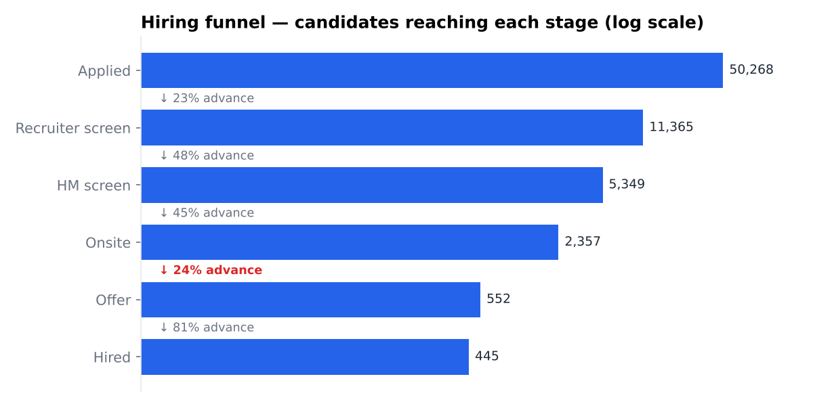
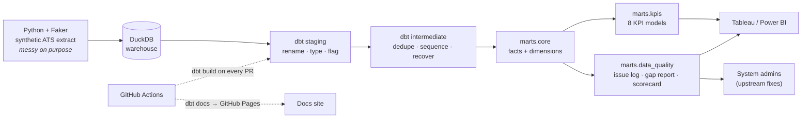
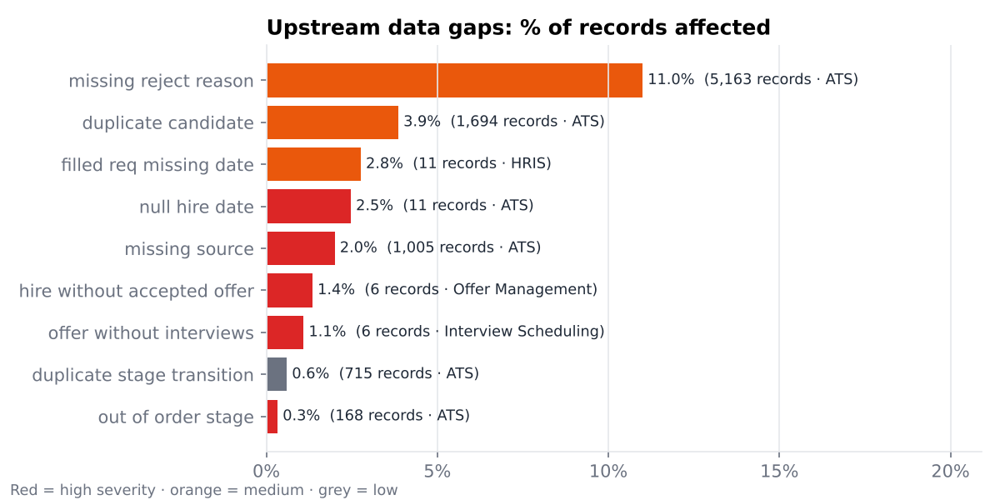

# Recruiting Funnel Analytics Platform

[](https://github.com/dhruti9/recruiting-funnel-analytics/actions/workflows/ci.yml)
[](https://dhruti9.github.io/recruiting-funnel-analytics/)

An end-to-end, tested and documented analytics pipeline over applicant-tracking-system (ATS) data. It takes a messy recruiting extract, models it into a clean star schema, computes the KPIs a talent team runs on, and reports the upstream data problems back to the people who own the source systems.

**33 dbt models · 180 data tests · CI on every pull request · 50K applications**

| | |
|---|---|
| 📊 **Findings memo** | [INSIGHTS.md](INSIGHTS.md): a one-page summary for a non-technical recruiting leader |
| 📚 **Data docs & lineage** | [dbt docs site](https://dhruti9.github.io/recruiting-funnel-analytics/) (published by GitHub Actions) |
| 📈 **Dashboard** | [dashboard/](dashboard/): chart previews, Tableau-ready extracts and a build guide |



---

## Architecture



| Layer | Models | What happens |
|---|---|---|
| `staging` | 9 | One model per raw table. Renamed, typed and lightly normalized. **No rows are removed.** Problems are flagged, not hidden. |
| `intermediate` | 5 | Candidate de-duplication, logical stage sequencing with time-in-stage, hire dates and fill dates recovered from event history, offer status corrected with ATS evidence. |
| `marts/core` | 8 | `fct_applications`, `fct_stage_transitions`, `fct_offers`, `dim_requisition`, `dim_candidate`, `dim_recruiter`, `dim_source`, `dim_department` |
| `marts/kpis` | 8 | One model per recruiting KPI (see below). |
| `marts/data_quality` | 3 | `dq_issue_log`, `dq_upstream_gap_report`, `dq_scorecard` |

## KPI definitions

| KPI | Model | Definition |
|---|---|---|
| **Time to fill** | `kpi_time_to_fill` | Days from requisition open to the hire that consumed its last headcount. Median and p75 by month and department. |
| **Time to hire** | `kpi_time_to_hire` | Days from application to hire, by month and source. |
| **Stage conversion** | `kpi_stage_conversion` | `advanced ÷ (entered − still in stage)` for each stage, overall and by source. Candidates still waiting are excluded so recent months aren't understated. |
| **Drop-off by stage** | `kpi_stage_dropoff` | Share of candidates who leave at each stage, split into rejected, withdrew and declined, with the top rejection reason. |
| **Offer acceptance rate** | `kpi_offer_acceptance` | `accepted ÷ (accepted + declined)`. Rescinded and pending offers are not candidate decisions and are excluded. |
| **Source effectiveness** | `kpi_source_effectiveness` | Hires per 1,000 applications, hire rate relative to job boards, and **cost per hire**: `applications × cost per application + hires × flat fee + agency % × hired base salary`. |
| **Pipeline aging** | `kpi_pipeline_aging` | Active applications bucketed by days since last activity (0–7, 8–14, 15–30, 31–60, 60+). |
| **Recruiter workload** | `kpi_recruiter_workload` | Open reqs, active and stale pipeline (more than 30 days untouched), and trailing-12-month hires and fills per recruiter. |

## Data quality: tests that mean something

The generator injects the problems real ATS and HRIS integrations produce. The pipeline has to survive every one of them, and report each back to the team that owns the system.

| Injected problem | How the pipeline handles it | Reported to |
|---|---|---|
| Missing reject reasons | Kept and flagged; excluded from reason breakdowns | ATS admins |
| Missing source | Mapped to an explicit `Unattributed` source, so the record is counted rather than dropped | ATS admins |
| Duplicate candidate profiles | Merged on normalized email in `int_candidates__resolved` | ATS admins |
| Stage timestamps out of order | Detected; the application is quarantined from duration KPIs | ATS admins |
| Duplicate stage events (re-sync) | Removed in sequencing | ATS admins |
| Hired with NULL hire date | Recovered from the `hired` stage event | ATS admins |
| Hire whose offer is still "pending" | Corrected to accepted using ATS evidence | Offer Management admins |
| Offer with no interview records | Flagged | Interview Scheduling admins |
| Filled requisition with no fill date | Recovered from the last hire | HRIS admins |

**Two kinds of tests, on purpose:**

- **`severity: warn`** tests on staging describe *known upstream problems*. They show up in every CI run with a row count, but never block a merge. Each one maps to a row in `dq_upstream_gap_report`.
- **`severity: error`** tests on intermediate and marts are *guarantees this project makes*. Any failure blocks the merge.

Beyond the built-in `unique`, `not_null`, `relationships` and `accepted_values` tests, the project defines:

| Custom test | Type | Guarantees |
|---|---|---|
| `assert_stage_timestamps_sequential` | singular | No non-quarantined application has a stage entered before the previous one, or exited before it was entered |
| `assert_hire_has_accepted_offer` | singular | Every hire has an offer, and that offer is accepted |
| `assert_hire_after_offer` | singular | Nobody is hired before their offer was extended |
| `assert_hires_within_headcount` | singular | A requisition never has more hires than approved headcount |
| `assert_funnel_is_consistent` | singular | Candidates entering stage N+1 equal those advancing out of stage N, for every source (catches join fan-out) |
| `assert_source_kpis_reconcile_to_fact` | singular | Source KPIs account for every application and hire |
| `assert_gap_report_reconciles_to_issue_log` | singular | The gap report accounts for every logged issue |
| `sequential_timestamps` | generic | Reusable: timestamps never go backwards within a partition |
| `not_negative`, `accepted_range`, `expression_is_true`, `unique_combination_of_columns` | generic | Reusable column and row assertions, with no package dependency |



## CI/CD

- **`.github/workflows/ci.yml`** runs on every pull request and push to `main`. It installs pinned dependencies, regenerates the raw extract and runs `dbt build` (all models and all tests). The job summary lists pass, warn and error counts and every known upstream issue.
- **`.github/workflows/docs.yml`** runs on every push to `main`. It builds the project, generates the static dbt docs site (lineage graph, model and column descriptions, tests) and deploys it to GitHub Pages.

To make a failing test **block the merge**, protect `main` under *Settings → Branches* and require the `dbt-build` status check.

## How to run

Requires Python 3.11+.

```bash
git clone https://github.com/dhruti9/recruiting-funnel-analytics.git
cd recruiting-funnel-analytics
pip install -r requirements.txt

make all     # generate data → dbt build → export dashboard data and charts
make docs    # browse the dbt docs site locally
```

Without `make`:

```bash
python data_generator/generate.py --out data/raw
cd dbt_project && dbt build --profiles-dir . && cd ..
python scripts/export_for_dashboard.py
```

The warehouse is a single DuckDB file (`dbt_project/recruiting.duckdb`). To run on PostgreSQL instead, install `dbt-postgres`, add a target to `profiles.yml` and load `data/raw/*.csv` into a `raw` schema. The models use only standard SQL apart from a few DuckDB date helpers.

Data generation is seeded (`data_generator/config.py`), so every run produces identical numbers.

## Repository layout

```
recruiting-funnel-analytics/
├── data_generator/          # Python + Faker synthetic ATS extract (config.py = tuning knobs)
├── dbt_project/
│   ├── models/staging/      # 9 models + _sources.yml + _stg_models.yml
│   ├── models/intermediate/ # 5 models
│   ├── models/marts/        # core/ · kpis/ · data_quality/
│   ├── tests/               # 7 singular business-rule tests
│   ├── tests/generic/       # 5 reusable generic tests
│   ├── seeds/               # system owners + data-quality check catalog
│   └── macros/
├── scripts/                 # export marts → dashboard/data + charts
├── dashboard/               # chart previews, Tableau-ready CSVs, build guide
├── .github/workflows/       # ci.yml (dbt build on PR) · docs.yml (dbt docs → Pages)
├── INSIGHTS.md              # findings memo for a non-technical audience
└── Makefile
```

---

*All data is synthetic and generated by `data_generator/`. No real candidate information is used.*
