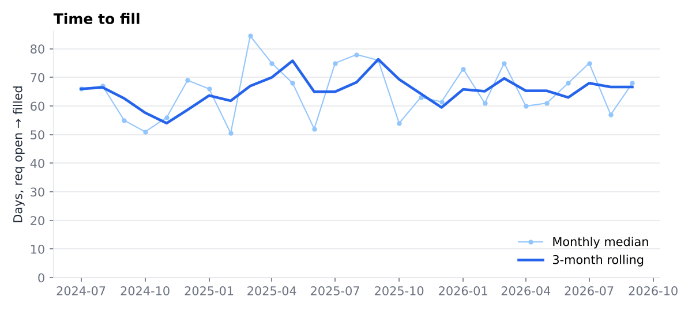
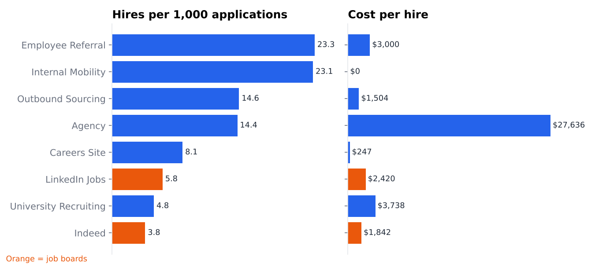

# Dashboard

Static previews of the four dashboard views are in `img/`. The dashboard-ready extracts they are drawn from are in `data/`. Both are regenerated by `make dashboard`.

| View | Preview | Source extract |
|---|---|---|
| Hiring funnel |  | `kpi_stage_conversion.csv`, `kpi_stage_dropoff.csv` |
| Time-to-fill trend |  | `kpi_time_to_fill.csv` |
| Source comparison |  | `kpi_source_effectiveness.csv` |
| Data-quality scorecard |  | `dq_upstream_gap_report.csv`, `dq_scorecard.csv` |

**Tableau Public:** _add your published link here_

## Building it in Tableau Public

1. Open Tableau Public and connect to each CSV in `data/` as a text file. Each one is a separate data source, so no joins are needed.
2. **Funnel.** From `kpi_stage_conversion`, filter `source_name = All sources`. Put `from_stage` on Rows sorted by `stage_order`, and `entered` on Columns as a bar. Add `conversion_rate` as a label. Expose `source_name` as a filter so viewers can compare sources.
3. **Time to fill.** From `kpi_time_to_fill`, put `filled_month` (continuous month) on Columns and `median_time_to_fill_days` on Rows. Filter `department_name` with `All departments` as the default.
4. **Source comparison.** From `kpi_source_effectiveness`, make two horizontal bars side by side: `hires_per_1k_applications` and `cost_per_hire_usd`. Color by `source_type`.
5. **Data-quality scorecard.** From `dq_scorecard`, make a text table of `quality_score` by `source_system`, colored by `health_status`. Below it, add a bar of `pct_affected` by `issue_type` from `dq_upstream_gap_report`, colored by `severity`, with `owning_team` and `recommended_fix` in the tooltip.
6. Combine the four sheets on one dashboard, publish to Tableau Public, and paste the link above and in the top-level README.

Power BI works the same way: *Get data → Text/CSV*, one table per file.
